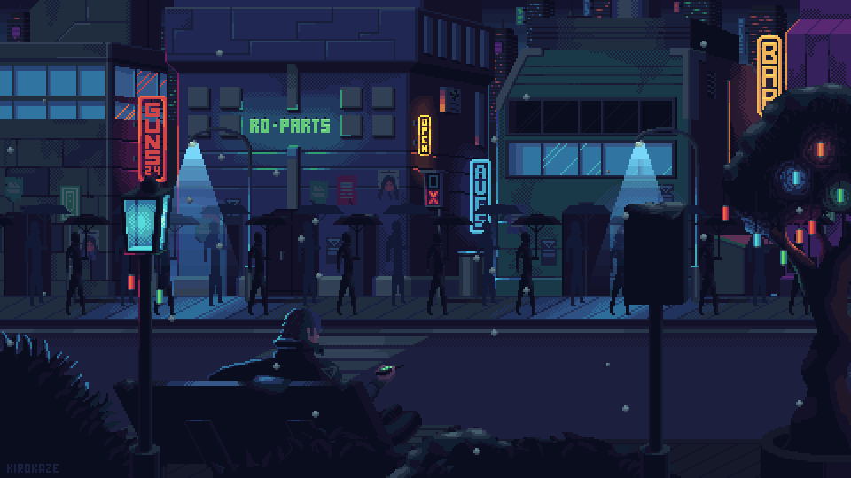

Olá 👋, eu sou Cauã Adriel</h1>
<h3 align="center">Programador | BackEnd & FrontEnd | Estudante de Ciência da Computação</h3>

---

## 👨‍💻 Sobre mim

Sou Programador com formação técnica em Informática pelo Instituto Federal do Amazonas (IFAM) e atualmente graduando em Ciência da Computação.

Atuo com desenvolvimento BackEnd e FrontEnd, com foco em aplicações web, automação e soluções voltadas à tecnologia e inovação. Atualmente trabalho na Visteon Corporation, empresa multinacional do setor automotivo especializada no desenvolvimento de soluções inteligentes para veículos, como clusters e rádios com integração android automotive.

Possuo interesse em Engenharia de Software, Inteligência Artificial, Internet das Coisas (IoT), automação e desenvolvimento de sistemas escaláveis, buscando constantemente aprimorar minhas habilidades técnicas e profissionais através de projetos, estudos e experiências práticas.

---

## 🚀 Linguagens • 🛠️ Tecnologias/Ferramentas • 🐧 Sistemas

### 💻 Linguagens

### 🛠️ Tecnologias e Ferramentas

### 🐧 Sistemas

---

## 📊 Minha Atividade no GitHub

---

<picture>
  <source media="(prefers-color-scheme: dark)" srcset="https://raw.githubusercontent.com/adriel1901/adriel1901/output/snake-dark.svg">
  <source media="(prefers-color-scheme: light)" srcset="https://raw.githubusercontent.com/adriel1901/adriel1901/output/snake.svg">
  
</picture>

---
